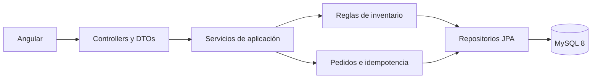

# ChefTable API

API REST para pedidos en mesa construida con Spring Boot, Spring Security, JPA, Flyway y MySQL. El proyecto demuestra reglas de negocio transaccionales, control de inventario concurrente, idempotencia HTTP y autorización por roles.

Frontend: [Angular-ChefTable](https://github.com/dayanaArmasB/Angular-ChefTable)

## Capacidades principales

- Menú público y validación de mesas activas.
- Creación transaccional de pedidos.
- Precios recalculados siempre en el servidor.
- Reserva de inventario con bloqueos y orden estable.
- Idempotencia para reintentos de `POST /api/v1/orders`.
- Seguimiento mediante código público no secuencial.
- Flujo de cocina con transiciones de estado válidas.
- Devolución de stock controlada al cancelar.
- JWT, BCrypt y roles `ADMIN` y `KITCHEN`.
- Migraciones de esquema y datos base con Flyway.
- OpenAPI/Swagger, Testcontainers y pruebas de carga con k6.

## Arquitectura



Se mantiene un monolito modular: suficiente separación para el alcance del proyecto sin introducir la complejidad operativa de microservicios.

## Requisitos

- Java 17
- Docker Desktop o MySQL 8
- PowerShell para el script local incluido

## Inicio local

1. Crear una base MySQL llamada `spring`.
2. Copiar `.env.example` como `.env`.
3. Completar las credenciales locales y un `JWT_SECRET` Base64 de al menos 32 bytes aleatorios.
4. Ejecutar:

```powershell
.\run-local.ps1
```

La API quedará disponible en `http://localhost:8080`. Flyway creará y actualizará el esquema automáticamente.

## Pruebas

```powershell
.\test-local.ps1
```

En Windows, el script conecta Testcontainers con Docker Desktop sin alterar la configuración global. Testcontainers levanta MySQL 8.4 y verifica carreras por la última unidad, reintentos idempotentes, cancelaciones y bloqueos cruzados. Sin Docker, las pruebas de integración se omiten y continúan las pruebas unitarias.

GitHub Actions ejecuta `verify` con Java 17 en cada cambio dirigido a `main`.

## OpenAPI

Con la API iniciada, la especificación y la interfaz de Swagger están disponibles en las rutas configuradas por Springdoc. En el proyecto, el acceso a la documentación se restringe según las reglas de seguridad definidas para personal autorizado.

## Seguridad

- `.env` está ignorado y no forma parte del historial del repositorio.
- `application.properties` solo referencia variables de entorno.
- CORS utiliza orígenes explícitos.
- Las contraseñas se almacenan con BCrypt.
- La API valida roles, cantidades, mesas, precios, stock y estados.
- En producción se requiere TLS, rate limiting externo y un gestor de secretos.

Consulta [Concurrencia, idempotencia y seguridad](docs/CONCURRENCY_AND_SECURITY.md) para ver decisiones, escenarios y comandos de carga.
